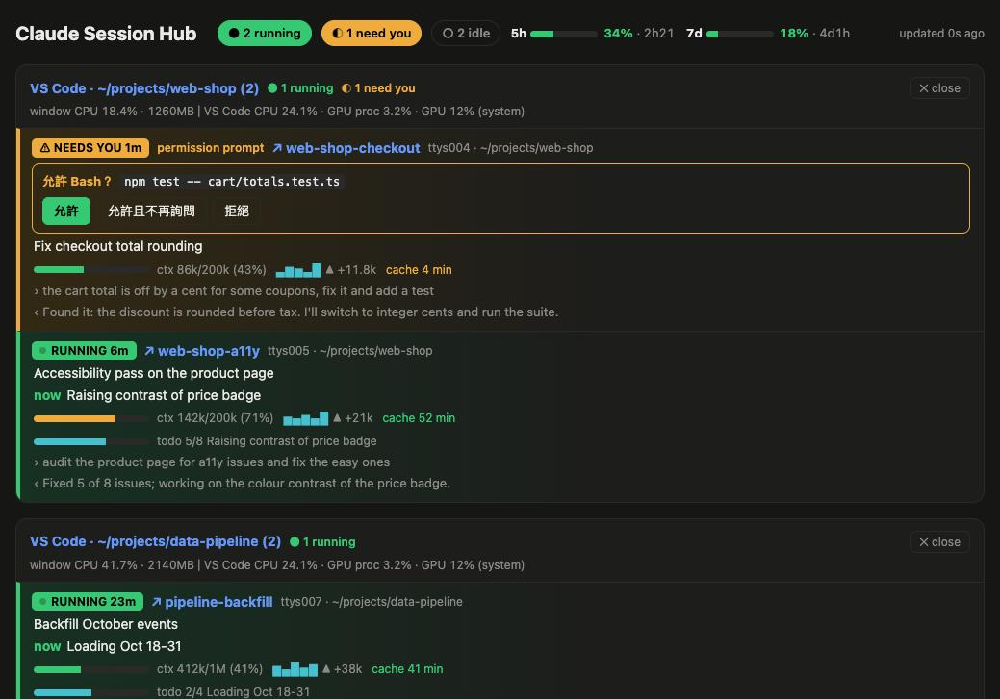
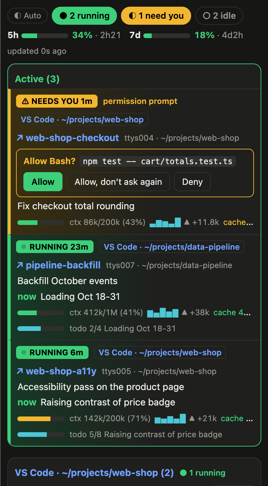

# Claude Session Hub

[English](README.en.md) | 繁體中文

一次看清楚、也能操控這台 Mac 上**所有** Claude Code session：哪個在跑、哪個在等你回答、context 用了多少、它的 VS Code 視窗吃多少 CPU/GPU。在終端機、瀏覽器、Chrome 側邊欄和手機上都能用。

這個 repo 本身是一個 Claude Code plugin marketplace（`claude-session-hub`），裡面有一個 plugin：**session-progress**。





**Chrome 側邊欄**（右圖）：瀏覽任何網頁時，右側都能看到所有 session；工具列圖示的徽章顯示有幾個在等你。

截圖用的是示範資料。介面文字一律是英文。

<br clear="right">

## 功能

| | |
|---|---|
| **總覽** | 等你回答、執行中、剛完成的 session 置頂在「Active」區（依這個順序，並標出所在視窗），其餘依 VS Code 視窗分組；狀態徽章：`⚠ NEEDS YOU`、`▶ RUNNING`、`✓ DONE 2m`、`○ idle 3h12m` |
| **剛完成** | 跑完 10 分鐘內標成 `✓ DONE 2m ✕`，留在 Active 區，不會一跑完就掉回下面；點這個徽章就移到下面的 idle 群組，各個畫面同步 |
| **Context** | 用量條（`245k/1M`）、每次 prompt 的增量小圖（`▂▇▅▃█ ▲ +10.1k`）、prompt cache 剩餘時間 |
| **用量限制** | 帳號的 5 小時和 7 天限制百分比、何時重置 |
| **資源** | 每個 VS Code 視窗的 CPU 和記憶體，VS Code 的 GPU process 和系統 GPU 使用率 |
| **跳轉／關閉** | 點 session 名稱就跳到那個 VS Code 視窗和 terminal；按兩次「✕ close」關閉視窗 |
| **停止** | 執行中的 session 有 `■ Stop` 按鈕，按兩次就在它的 terminal 按 Esc 中斷（只在它還在同一次執行時送出） |
| **回答詢問** | session 卡在權限詢問或問題時，直接在 web 上點「Allow／Deny」或選答案 |
| **區網／手機** | 選用；只有帶密鑰的網址才連得進來 |
| **Chrome 側邊欄** | 瀏覽器右側常駐面板，工具列徽章顯示等待中和執行中的 session 數 |
| **通知** | session 等你回答或跑完時跳 macOS 通知，點通知直接跳到那個 VS Code terminal；在工具列圖示按右鍵可以分別關掉兩種通知 |
| **提示音、語音和 macOS 通知** | session 跑完時由本機伺服器先播一聲系統提示音（Glass、Ping、Hero 等，可各自選），再用 macOS `say` 唸出專案資料夾和這個 session 在做什麼（它的標題），例如「kitt nav 固定回覆句子列表，完成了」，標題有中文時改用中文語音 Meijia，並跳 macOS 原生通知；也可以開啟「需要你」時提醒。在 ⚙ 設定頁的 Alerts on this Mac 分別開關，有試聽按鈕。伺服器在跑時才會提醒 |
| **設定** | 右上角 ⚙：主題（自動跟著 macOS／淺色／深色），以及每個小資訊要不要顯示：用量限制、視窗 CPU／記憶體、context 條、增量小圖、cache 時間、todo、目前步驟、最後的 prompt 和回覆。每個瀏覽器各自記住，Chrome 側邊欄共用同一份 |

## 需求

- macOS（用了 `ps`、`ioreg`、`launchctl`、`open`）
- Claude Code
- Python 3（只用標準函式庫）
- VS Code：跳轉、關閉、回答功能需要，並安裝附的擴充

## 安裝

### 1. 安裝 plugin

在 Claude Code 裡執行：

```
/plugin marketplace add timlai10002-tech/claude-session-hub
/plugin install session-progress@claude-session-hub
```

如果是 clone 到本機自己開發：

```
claude plugin marketplace add ~/claude-session-hub
claude plugin install session-progress@claude-session-hub --scope user
```

改了程式碼之後，在各 session 執行 `/reload-plugins` 就會生效。

### 2. 安裝 VS Code 擴充（建議）

跳轉、關閉視窗、從 web 回答詢問都靠它；精確的每視窗 CPU 統計也需要它。

```
cd session-progress/vscode-extension
python3 make_vsix.py
code --install-extension claude-terminal-focus-*.vsix
```

裝好後，在每個已經開著的 VS Code 視窗執行一次 **Developer: Reload Window**。

## 使用

| 指令或網址 | 內容 |
|---|---|
| `/sessions` | 在 Claude Code 裡打開 sessions 面板 |
| `/sessions-web` | 啟動本機伺服器並在瀏覽器打開 `http://127.0.0.1:8787/` |

### Chrome 側邊欄

1. 打開 `chrome://extensions`，開啟「開發人員模式」
2. 按「載入未封裝項目」，選 `session-progress/chrome-extension`
3. 把工具列圖示釘選出來，點一下就會打開右側面板

側邊欄只是顯示本機的 web 頁面，所以要先執行過 `/sessions-web`。

### 區網和手機

```
touch session-progress/web/lan.enabled
```

然後重啟伺服器（結束 `server.py` 程序後再執行 `/sessions-web`）。`/sessions-web` 會印出區網網址，格式是 `http://<IP>:8787/k/<密鑰>/`。

- 沒帶密鑰、或密鑰錯誤的連線一律回 404。
- 拿到網址的人可以做你能做的所有事：允許指令、關閉視窗。只給你信任的裝置。
- 連線是 HTTP，沒有加密。不要在公共 Wi‑Fi 上開。
- 換密鑰：刪掉 `web/lan.key` 再重啟伺服器。
- 關閉區網：刪掉 `web/lan.enabled`。
- 想在外面用手機連回來，建議用 [Tailscale](https://tailscale.com)，不要直接把服務開到網際網路上。

## 分享給沒有裝 Claude Code plugin 的人

```
python3 session-progress/chrome-extension/make_bundle.py
```

會產生 `session-progress/dist/claude-sessions-chrome.zip`。對方解壓縮後執行 `bash install.sh`，會在 `~/Library/Application Support/claude-sessions` 安裝本機伺服器並設成登入時自動啟動，再到 Chrome 載入擴充就能用。詳見 zip 裡的 `README.md`。

這個版本沒有 5h/7d 用量限制那一行（只有 Claude Code 引擎拿得到）。

## 運作方式

```
~/.claude/sessions/*.json  ─┐
~/.claude/projects/*.jsonl ─┼─► hooks/scan.py ─► /sessions 面板（register.tsx）
ps / ioreg                 ─┘          │
                                       └─► web/server.py ─► 瀏覽器 / Chrome 側邊欄 / 手機
                                               │
          VS Code 擴充 ◄── request.json ──┘  hooks/vscode.py：跳轉、關閉、送按鍵
```

- **scan.py** 讀 Claude Code 的 session 註冊檔和 transcript，算出狀態、context、增量、cache 時間，再用 `ps` 找出每個 session 屬於哪個 VS Code 視窗。
- **register.tsx** 是 plugin 本體：每 5 秒掃描一次並畫出面板，把用量限制寫給 web 用，並在每次工具呼叫前記下它要做什麼，讓 web 能顯示 session 在等你回答什麼。
- **VS Code 擴充** 每 5 秒寫一次心跳（視窗資料夾、terminal 的 shell pid），並監看 `~/.claude/terminal-focus/request.json`，負責跳轉、關閉視窗，以及把一個數字或 Esc 送進 terminal。

## 安全設計

- 伺服器預設只聽 `127.0.0.1`。
- POST 請求必須帶 `X-Sessions: 1` header，其他網站的頁面沒辦法在不經過 CORS preflight 的情況下送出，而伺服器不會核准任何 preflight。
- Host header 必須是 localhost 或 IP 位址，防 DNS rebinding。
- 區網模式下，非本機的請求必須帶密鑰路徑，比對用 `secrets.compare_digest`。
- 從 web 回答 terminal 裡的詢問時，只送一個數字或 Esc，而且送之前會確認那個 session 還在同一次等待中，避免多打一個按鍵到輸入框。

## 開發

```
cd session-progress
claude plugin validate .
claude plugin test .
```

| 路徑 | 內容 |
|---|---|
| `session-progress/hooks/register.tsx` | plugin 本體：面板、指令、工具呼叫紀錄 |
| `session-progress/hooks/progress.test.ts` | plugin 測試 |
| `session-progress/hooks/scan.py` | 掃描所有 session |
| `session-progress/hooks/vscode.py` | 對 VS Code 擴充發出跳轉、關閉、按鍵請求 |
| `session-progress/types/index.d.ts` | plugin state 的型別 |
| `session-progress/web/` | 本機伺服器、總覽頁 |
| `session-progress/vscode-extension/` | claude-terminal-focus 擴充 |
| `session-progress/chrome-extension/` | Chrome 側邊欄和分享用打包腳本 |
